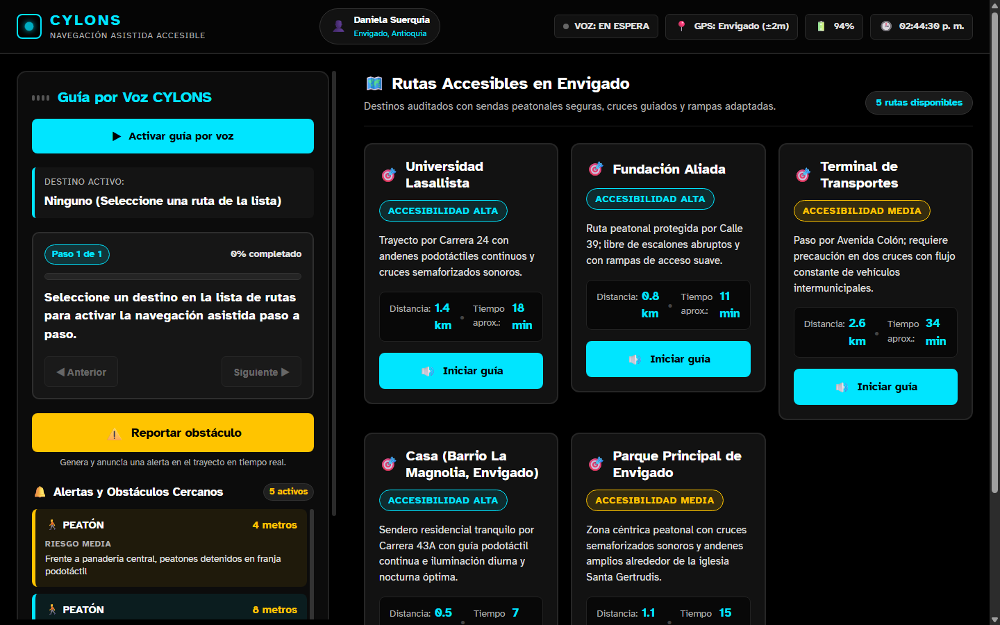
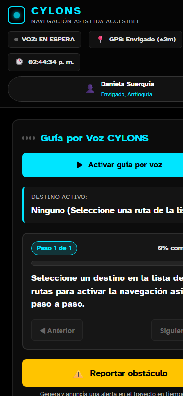
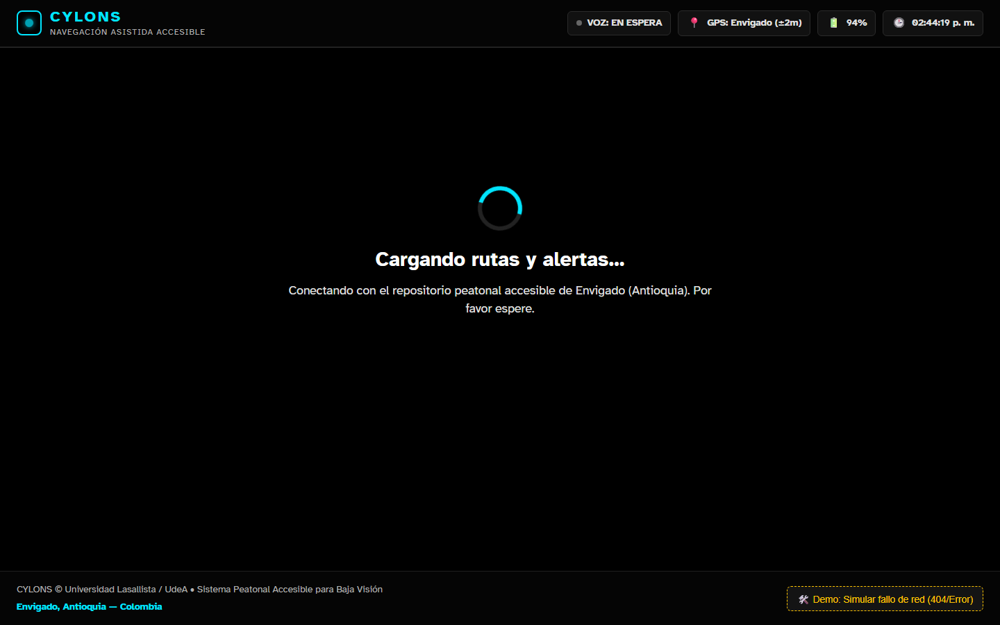

# PROYECTO CYLONS
**Sistema de Asistencia de Navegación Peatonal para Personas con Discapacidad Visual**

**PRESENTADO POR:**  
Sara Cardona Lastra  
Daniela Sucerquia Armesto  

**DOCENTE:**  
Neider Xavier Vergara  

**ASIGNATURA:**  
Desarrollo Web  

**INSTITUCIÓN:**  
Corporación Universitaria Lasallista  
Facultad de Ingeniería  
Medellín / Caldas, Antioquia  
Octubre 2026  

---

## 1. Planteamiento del problema
Este proyecto de investigación se centra en ayudar a personas con discapacidad visual a realizar tareas cotidianas utilizando un “softbot” basado en tecnología de aprendizaje automático. La pregunta general es cómo esta tecnología puede mejorar la vida de estas personas, y las preguntas específicas abordan cómo se relacionan con su entorno y los beneficios que podrían obtener. La justificación se basa en la importancia de la tecnología en la vida moderna y la necesidad de mejorar la calidad de vida de las personas con discapacidad visual.

La hipótesis sugiere que implementar un softbot tendrá un impacto positivo en la independencia, la calidad de vida y la participación social de los usuarios, al mejorar su interacción con el entorno y brindar beneficios emocionales y físicos. El marco referencial destaca la importancia de la tecnología en la inclusión de personas con discapacidad visual.

La metodología propuesta incluye la selección de participantes con discapacidad visual, un diseño experimental para comparar antes y después de la implementación de tecnologías de asistencia, recopilación de datos a través de encuestas, entrevistas y observaciones, análisis cualitativo y la edición del softbot en base a las preferencias de los usuarios y la comparación con otros sistemas similares.

En resumen, el proyecto busca mejorar la vida de personas con discapacidad visual mediante el uso de un softbot basado en inteligencia artificial y tiflotecnología, con un enfoque en la autonomía, calidad de vida y participación social.

---

## 2. Justificación del proyecto
La tecnología, desde su invención ha sido un elemento fundamental en la vida de las personas. Desde hace unos años, hasta hoy en día han creado softwares, capaces de realizar casi que cualquier actividad por nosotros, pero, también hay un pequeño porcentaje de personas, que tienen su capacidad visual reducida, y hasta se les dificulta realizar las actividades más sencillas en su propia casa (Prender y apagar luces, ajustar temperaturas y leer cualquier cosa). Como nos dice M. Rosario Luna 2013:

> *“Es de suma importancia conocer las diferentes alternativas que nos proporciona el uso de la tecnología, así como rediseñar los sistemas de enseñanza-aprendizaje en todos los espacios educativos… Es necesario construir modelos pedagógicos que impliquen su uso en beneficio de las personas en condición capacidad visual reducida.”*

---

## 3. Solución propuesta
Se propone el desarrollo de **CYLONS**, un agente de software inteligente (*softbot*) móvil e integrado que combina un sistema de mapeado para la orientación en trayectos cotidianos con un programa avanzado de conversión de texto a voz (*Text-To-Speech*, TTS). La aplicación está diseñada para funcionar en dispositivos móviles de gama media-baja sin necesidad de hardware externo adicional, permitiendo al usuario interpretar su entorno urbano, reconocer espacios y desplazarse con mayor independencia y seguridad.

---

## 4. Público objetivo
* **Público objetivo:** Personas con discapacidad visual (baja visión o ceguera total), de cualquier edad, con uso habitual de dispositivos tecnológicos.
* **Requerimientos del usuario:**
  * Requerir asistencia auditiva mediante conversión de texto a voz para recibir información del entorno.
  * Consultar y configurar rutas de desplazamiento urbano cotidiano mediante el sistema de mapeado del softbot.
  * Adaptar las preferencias de interacción del software de acuerdo con sus necesidades de accesibilidad.
* **Estrato social:** CYLONS está diseñado para funcionar en dispositivos móviles de gama media baja sin necesidad de hardware adicional especializado, lo que facilita su acceso desde los estratos 2 y 3 en adelante en Colombia. Asimismo, las funciones de mapeado y guiado en trayectos aprovechan las capacidades de geolocalización y conectividad móvil disponibles en dichos dispositivos.

---

## 5. Alcance y funcionalidades iniciales
El proyecto contempla el desarrollo de las siguientes funcionalidades clave orientadas a garantizar la autonomía y usabilidad por parte de los usuarios finales:

* **Configuración de perfil:** El usuario puede configurar y consultar su perfil de accesibilidad y preferencias dentro de la aplicación.
* **Asistencia por Voz:** El usuario puede activar el sistema de conversión de texto a voz para la lectura de información del entorno.
* **Selección de Destinos:** El usuario puede ingresar o seleccionar un destino para recibir indicaciones de mapeado y orientación en trayectos cotidianos.
* **Orientación en Tiempo Real:** El usuario puede recibir alertas y orientaciones auditivas en tiempo real durante sus desplazamientos urbanos.
* **Gestión de Rutas:** El usuario puede gestionar rutas frecuentes o guardadas para facilitar su movilidad recurrente.

---

## 6. Prototipo conceptual (Mockup de la Primera Entrega)
En la primera fase del proyecto se diseñaron las siguientes pantallas conceptuales de alta fidelidad que sirvieron como referencia funcional y visual:


*(Vistas de Inicio, Catálogo de Rutas, Navegación en Ruta a Universidad Lasallista, Ajustes de Voz y Audio, y Perfil del Usuario).*

---

# SEGUNDA ENTREGA: EVOLUCIÓN FRONT-END EN ANGULAR

---

## 7. Evolución desde la primera entrega
Mientras que la primera entrega estableció el planteamiento conceptual, la justificación y los prototipos iniciales de CYLONS, esta segunda entrega materializa la propuesta en una **aplicación Front-End interactiva, ejecutable y modular desarrollada en Angular 18+ (Angular 21) y TypeScript en modo estricto**.

### De maquetas estáticas a un sistema web dinámico:
1. **Componentización estructurada:** Se reemplazó el diseño estático por una jerarquía de componentes *standalone* con responsabilidades exclusivas (`StatusBar`, `RouteList`, `RouteCard`, `VoicePanel` y `AppComponent`).
2. **Fuente de datos externa y asíncrona:** La información ya no está dibujada en imágenes; ahora proviene de un archivo JSON externo simulado (`cylons-data.json`), consumido mediante el cliente HTTP de Angular (`HttpClient`) con latencia perceptible (`delay(900)`).
3. **Manejo de estado reactivo con Angular Signals:** En lugar de variables dispersas o suscripciones manuales complejas, se emplean Signals (`signal`, `computed`, `effect`) para gobernar de forma atómica los estados de carga, error y visualización de rutas.
4. **Síntesis de voz real con Web Speech API:** Se transformó el concepto de audio en una implementación real mediante la API nativa de voz del navegador (`SpeechSynthesisUtterance`), configurada en español colombiano (`es-CO`), sin servicios de pago ni dependencias de terceros.
5. **Interacciones significativas comprobables:**
   * **Guía interactiva paso a paso:** Al pulsar *"Iniciar guía"* o *"Activar guía por voz"*, la app cicla instrucciones audibles mientras calcula y despliega el porcentaje de avance en una barra de progreso.
   * **Reporte de obstáculos en tiempo real:** Permite alertar sobre nuevos peligros viales (obras, peatones, escalones), actualizando el estado de manera inmutable y reordenando un radar de alertas por proximidad métrica inmediata.

---

## 8. Arquitectura actual de la solución

La aplicación implementa una arquitectura desacoplada y unidireccional que cumple estrictamente con el principio:  
**Fuente de datos externa → Servicio → Componente → Estado → Interfaz**

```
┌────────────────────────────────────────────────────────┐
│      public/assets/data/cylons-data.json               │  <-- Origen de datos JSON
└──────────────────────────┬─────────────────────────────┘
                           │ HttpClient.get()
                           ▼
┌────────────────────────────────────────────────────────┐
│            CylonsService (Servicio Global)             │  <-- Capa de datos y lógica
│  - delay(900) + tap() + catchError()                   │
│  - Signals: rutas, alertas, usuario, isLoading, error  │
└──────────────────────────┬─────────────────────────────┘
                           │
        ┌──────────────────┴──────────────────┐
        │                                     │
        ▼                                     ▼
┌──────────────────┐               ┌───────────────────────┐
│ VoicePanel Comp. │               │ RouteList Component   │  (Padre)
│ (Asistencia Voz) │               │ [@for de colección]   │
└──────────────────┘               └──────────┬────────────┘
                                              │ input() / output()
                                              ▼
                                   ┌───────────────────────┐
                                   │ RouteCard Component   │  (Hijo Reutilizable)
                                   └───────────────────────┘
```

---

## 9. Identificación de Modelos, Componentes y Servicios

### 9.1 Modelos de Datos Tipados (`src/app/models/`)
Definidos con TypeScript estricto y tipos de unión (*union types*):
* **`Ruta` (`ruta.model.ts`):** Modela cada trayecto peatonal. Incluye `id`, `nombreDestino`, `distanciaKm`, `tiempoEstimado`, `nivelAccesibilidad: 'alta' | 'media' | 'baja'`, y `descripcion` opcional.
* **`Alerta` (`alerta.model.ts`):** Representa obstáculos urbanos. Incluye `id`, `tipoAlerta: 'peatón' | 'obra' | 'escalón'`, `distanciaMetros`, `severidad: 'baja' | 'media' | 'alta'`, y `ubicacion`.
* **`Usuario` (`usuario.model.ts`):** Perfil del usuario asistido (`nombre: 'Daniela Sucerquia'`, `nivelAsistencia`, `ciudad: 'Envigado, Antioquia'`).
* **`CylonsData` (`cylons-data.model.ts`):** Estructura agregadora de la carga externa.

### 9.2 Servicios (`src/app/services/`)
* **`CylonsService`:** 
  * Inyecta `HttpClient` para consumir `assets/data/cylons-data.json`.
  * Administra el estado global reactivo mediante `signal()`.
  * `cargarDatos()`: implementa `delay(900)` para que la carga sea visible, `tap()` para poblar las señales, `catchError()` para atrapar fallos con mensajes claros y `finalize()` para apagar `isLoading`.
  * `reportarObstaculo()`: crea una nueva alerta aleatoria y la inserta inmutablemente (`alertas.update(lista => [nueva, ...lista])`).
  * `alternarUrlDemo()`: utilidad para demostrar en vivo la pantalla de error.
* **`VozService`:**
  * Controla la síntesis de habla con la **Web Speech API nativa**.
  * Selecciona automáticamente la voz en español local (`es-CO`).
  * Métodos `hablar(texto)` y `detener()`, asegurando retroalimentación audible sin bloquear la interfaz.

### 9.3 Componentes (`src/app/components/`)
* **`StatusBarComponent` (Navbar superior):** Muestra la telemetría en tiempo real: reloj sincronizado cada segundo, nivel de batería, estado del GPS (Envigado ±2m) y el estado activo del sintetizador de voz mediante `input()`. Destruye sus temporizadores en `ngOnDestroy`.
* **`RouteListComponent` (Componente Padre):** Recibe la colección de rutas mediante `rutas = input.required<Ruta[]>()` y la ruta activa con `rutaActivaId = input<string | null>()`. Renderiza las tarjetas usando la directiva `@for (ruta of rutas(); track ruta.id)` y canaliza el evento hacia el componente raíz.
* **`RouteCardComponent` (Componente Hijo Reutilizable):** Representa cada destino accesible. Utiliza `ruta = input.required<Ruta>()`, `activa = input<boolean>()` y `seleccionar = output<Ruta>()`. Muestra el badge de accesibilidad, kilometraje, tiempo estimado y el botón que cambia a *"En curso"* deshabilitado cuando está activa.
* **`VoicePanelComponent`:** Panel de asistencia visual y auditiva. Utiliza `computed()` para generar las instrucciones paso a paso de la ruta y para ordenar las alertas de la más próxima a la más lejana. Dispone de un `effect()` sincronizado con un temporizador que avanza la guía y habla automáticamente. Contiene el botón de acción rápida *"Reportar obstáculo"*.
* **`AppComponent` (Componente Raíz):** Orquestador central. Invoca `cargarDatos()` en `ngOnInit`, mantiene las señales locales `rutaActiva` y `vozActiva`, y gobierna los **3 estados fundamentales** de la interfaz mediante `@if / @else if / @else`.

---

## 10. Obtención y Administración de la Información

1. **Cero Datos Quemados (*No Hardcoding*):** Ninguna plantilla HTML ni clase de componente tiene arreglos estáticos de rutas o alertas. Toda la información nace en `public/assets/data/cylons-data.json`.
2. **Flujo Asíncrono Controlado:** La solicitud HTTP procesa la respuesta mediante operadores reactivos de RxJS:
   * Si la petición es exitosa: se actualizan las señales `rutas`, `alertas` y `usuario`, y `errorMessage` se mantiene en `null`.
   * Si la petición falla (URL rota o desconexión): `catchError` intercepta el fallo y actualiza `errorMessage`, permitiendo que la plantilla conmute al estado de error.
3. **Inmutabilidad:** Cuando se reporta un nuevo obstáculo, no se muta el arreglo con `.push()`. Se genera un nuevo arreglo mediante `update(lista => [nueva, ...lista])`, permitiendo que las vistas y los `computed()` reaccionen de inmediato.

---

## 11. Evidencias del Funcionamiento (Pantallazos Explicados)

### Evidencia 1: Pantalla Principal en Escritorio (1440px)

* **Explicación:** Se observa la distribución a dos columnas con el Panel de Voz a la izquierda en modo *sticky* y el catálogo de 5 rutas peatonales a la derecha (Universidad Lasallista, Fundación Aliada, Terminal de Transportes, Casa y Parque Principal de Envigado). En la parte superior se observa la barra de estado con la usuaria Daniela Sucerquia, la hora activa y la precisión del GPS.

### Evidencia 2: Adaptabilidad Móvil (375px)

* **Explicación:** En pantallas reducidas (375px), el layout cambia a una sola columna vertical siguiendo la filosofía *Mobile-First*. Los botones superan los 48px de altura mínima, facilitando la interacción táctil en personas con baja visión o movilidad reducida.

### Evidencia 3: Estado 1 — Carga Asíncrona (Loading Spinner)

* **Explicación:** Mientras `isLoading()` es verdadero (900 ms de latencia simulada), la aplicación muestra un spinner animado en cian `#00E5FF` con roles `role="status"` y descripción textual en pantalla, indicando la sincronización de las rutas de Envigado.

### Evidencia 4: Estado 2 — Manejo de Error y Botón "Reintentar"

* **Explicación:** Si la fuente de datos es inaccesible, el estado `@else if (errorMessage())` muestra un panel de advertencia ámbar con el detalle del error y el botón interactivo **"Reintentar conexión"**, el cual vuelve a solicitar los datos al servicio.

### Evidencia 5: Estado 3 — Guía Activa, Barra de Progreso y Reporte de Obstáculos

* **Explicación:** Demostración de las interacciones significativas: al seleccionar un trayecto, el panel activa la síntesis por voz, muestra el paso actual y calcula la barra de progreso porcentual. El botón *"Reportar obstáculo"* agrega de inmediato la alerta y la sintetiza por voz.

---

## 12. Evidencias del Comportamiento Responsive

| Dispositivo / Resolución | Tipo de Layout | Comportamiento Técnico |
| :--- | :--- | :--- |
| **Móvil (375px)** | 1 Columna vertical | El Panel de Voz se sitúa arriba y las tarjetas de rutas se apilan debajo. Los controles se adaptan al 100% del ancho con padding táctil de 48px. |
| **Escritorio (1440px)** | 2 Columnas asimétricas (420px + flexible) | El Panel de Voz queda fijo (`position: sticky; top: 85px`) permitiendo al usuario desplazarse por el catálogo de rutas mientras mantiene a la vista las instrucciones y alertas. |

---

## 13. Dificultades Encontradas y Decisiones Tomadas

1. **Cumplimiento estricto de accesibilidad visual (WCAG AAA):**
   * *Dificultad:* Las librerías de componentes convencionales no ofrecen contrastes óptimos para usuarios con ceguera legal o baja visión profunda.
   * *Decisión:* Se creó una paleta personalizada en CSS puro sobre fondo `#000000`, acentos cian `#00E5FF` y advertencias ámbar `#FFC400`, logrando un contraste superior a 21:1 con tipografía de alta legibilidad (*Atkinson Hyperlegible*).
2. **Síntesis de voz accesible sin servicios de pago:**
   * *Dificultad:* APIs de terceros (como Google Cloud o Amazon Polly) requieren credenciales y facturación.
   * *Decisión:* Se utilizó la **Web Speech API nativa**, priorizando la voz en español local `es-CO` y dotando al sistema de autonomía total sin costos.
3. **Control del ciclo de voz y prevención de fugas de memoria:**
   * *Dificultad:* Los temporizadores de las instrucciones podían seguir hablando después de que el usuario pausaba la guía o abandonaba la vista.
   * *Decisión:* Se implementó `effect()` en Angular junto con la cancelación inmediata en `ngOnDestroy()` mediante `window.speechSynthesis.cancel()`.

---

## 14. Enlace al Repositorio y Demostración

* **Repositorio de Código en GitHub:**  
  `https://github.com/Daniela-Sucerquia/CYLONS-Frontend` *(o enlace institucional asignado)*
* **Comandos de ejecución local:**
  ```bash
  # 1. Instalar dependencias
  npm install --legacy-peer-deps

  # 2. Iniciar servidor local
  npm start
  # La aplicación abre automáticamente en: http://localhost:4200

  # 3. Compilación de producción
  ng build
  ```
* **Truco para demostración del error en vivo:**  
  En el pie de página de la aplicación se encuentra el botón **"🛠️ Demo: Simular fallo de red"** que cambia la URL del JSON a un recurso 404 para evidenciar el contenedor de error y la recuperación con el botón **"Reintentar conexión"**.
